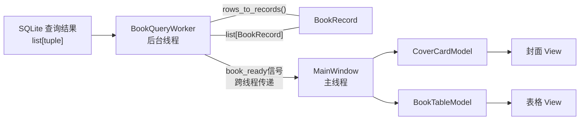
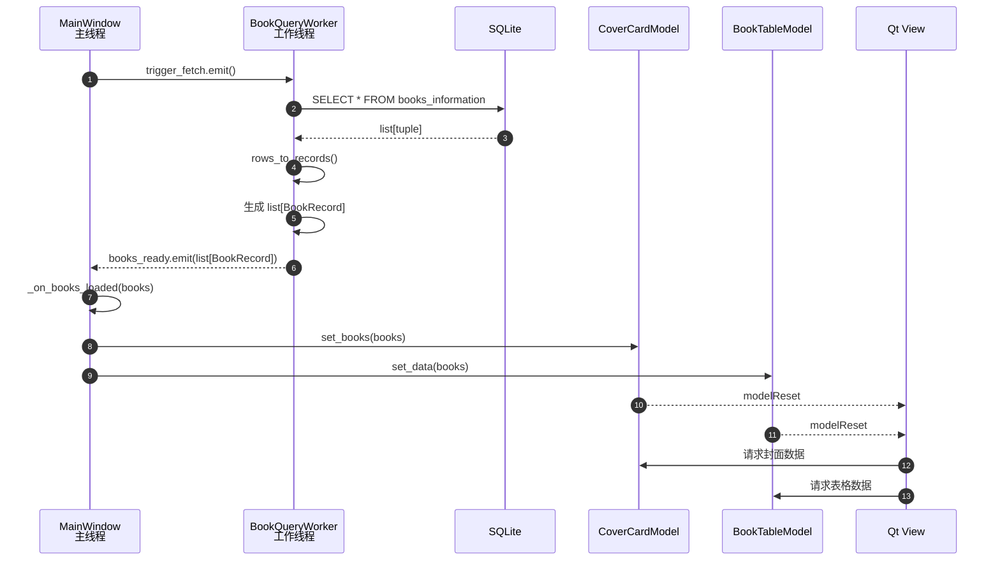

The repo is used for learning.  
本仓库仅用于个人学习。

将项目中的改动提交到本地仓库，同时推送到远程仓库中，每个文件分别提交commit（如果没有改动则不需要），提交作者中不要添加任何Co-Authored-By署名，commit内容使用中文撰写，类型前缀仍旧使用英文（例如docs: 修改readme.md内容）。

# Eternity-Library 项目简介
此项目用于开发个人图书馆项目，项目经费暂无、完成日期未知、编程经验不足。
本地书库主要实现以下功能（~~画饼~~）：  
1.自动扫描/手动添加散落于本地硬盘各个文件夹中的电子书籍（包括但不限于pdf，doc，txt，epub……），集中进行管理；  
2.直接在本地书库中阅读电子书籍并进行简单标注与编辑（包括书签功能），部分格式调用第三方软件（可能导致无法有效统计阅读时长）；  
3.对书籍进行阅读时长统计，阅读时长支持导出（数据无价！），具体格式暂时未定；  
4.每日阅读情况热力图；  
5.生成书籍阅读状态的甘特图，便于查看阅读的中断情况；  
6.年度阅读报告生成与分享；    
7.思维导图与书籍关联，点击导图可跳转至相应章节；

# 项目依赖包
见 pyproject.toml
# Python版本：3.12
# TODO
详见：https://github.com/users/seek2ever/projects/3

# 项目笔记

## Mermaid常用语法速查

flowchart TD	从上到下排列  

flowchart LR	从左到右排列  

A[文字]	矩形节点  

B{文字}	判断节点  

C((文字))圆形节点  

A --> B	带箭头的连线  

A --- B	不带箭头的连线

## 数据转换流程  
SQLite查询结果（list[tuple]）与BookRecord对象列表的转换流程如下：

时序图形式的数据转换流程如下：

## ScanBookFiles类中scan_book_files方法
1. any_books_found = False，用于判断是否有新书被添加，若有则在最后返回True，否则返回False；使用if not any_books_found进行判断时，若any_books_found为False（即if not any_books_found的值为Ture）时，满足Python的真值测试（在Python中，if后面的条件为True时执行后面的代码，否则跳过）；
2. GUI界面部件增加布局后，数据库中的数据可以正常显示；  
3. 后台查询线程逻辑：创建新线程对象
